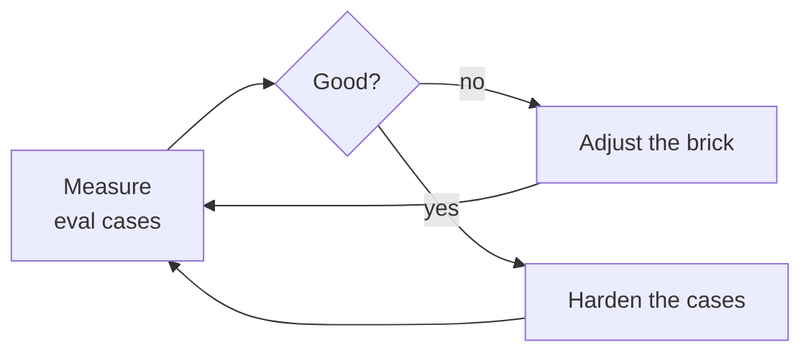

# Continuous improvement

The plugin will not be right the first time, like the code it produces. Every brick is measured by eval cases, fixed, then measured again.

## Who adds cases

Not the PO. There is no command to report a problem. A **routine** adds eval cases, drawn from what it observes: usage reports, escalations, dead ends already logged by the workflow. The same routine runs the evals, fixes a brick until its cases are green, then lowers its cost.

A case works like a unit test written after a bug: red first, green once the brick is fixed.

## Saving tokens

Same result, cheaper. "Same" is proven by green cases, so a saving is kept only if they stay green. Levers: a smaller model or lower effort, a shorter prompt, less context passed to bricks.

## Measuring real usage

Each orchestrator ends with a short statistics report (bricks called, loop turns, findings, fixes, duration — never project names). It shows what a new model makes obsolete, so unused bricks can be removed.
